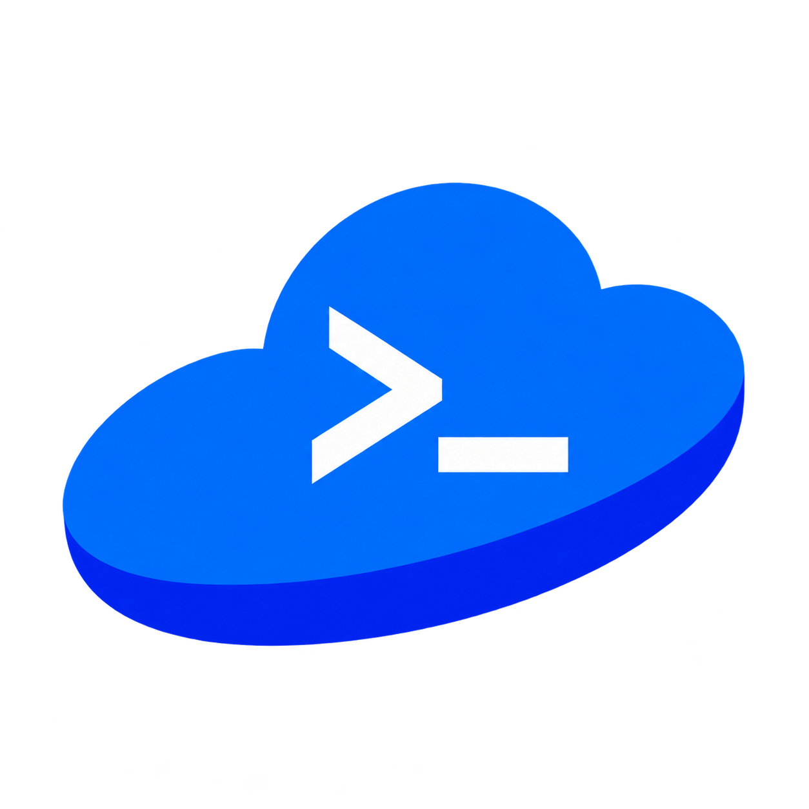

# Plaugin for Ya-Di

[](https://boosty.to/grebennikov.xyz/donate)<br>
<https://boosty.to/grebennikov.xyz/donate>

[](https://github.com/grebennikovxyz/yandex-disk/releases)
[](https://github.com/grebennikovxyz/yandex-disk/blob/main/LICENSE)
[](https://github.com/grebennikovxyz/yandex-disk/stargazers)
[](https://github.com/grebennikovxyz/yandex-disk/actions/workflows/release.yml)



Неофициальный ИИ-плагин для работы с Яндекс Диском из Codex, ChatGPT, Claude Code и OpenClaw. Плагин использует API Яндекс Диска. Исключительное право на товарный знак «Яндекс» принадлежит ООО «ЯНДЕКС». [Условия API](https://yandex.ru/legal/disk_api/ru/)

Подключаемый сервис


[Политика конфиденциальности](https://github.com/grebennikovxyz/yandex-disk/blob/main/PRIVACY.ru.md) · [Условия использования](https://github.com/grebennikovxyz/yandex-disk/blob/main/TERMS.ru.md)

Плагин подключает личный Диск через Яндекс ID. Можно найти фразу внутри документа, обновить ячейку в таблице, создать презентацию, сохранить вложение чата или восстановить файл из корзины. Загрузка и обработка идут с вашего компьютера.

Автор — **Anton @grebennikov.xyz**. [Проект на GitHub](https://github.com/grebennikovxyz/yandex-disk)

## Установка для Codex и ChatGPT Desktop

Потребуются [uv](https://docs.astral.sh/uv/getting-started/installation/), Git и локальный клиент с поддержкой MCP. Выполните в пользовательском терминале:

```shell
uv tool install --python 3.13 git+https://github.com/grebennikovxyz/yandex-disk.git@main
uv tool update-shell
```

Откройте новый терминал. Команда ниже открывает окно **«Войти через Яндекс»**. Выберите обычный доступ или «Только чтение». Для терминала без Tk используйте `yandex-disk-plugin login` или `yandex-disk-plugin login --read-only`.

```shell
yandex-disk-plugin connect
```

В Codex CLI добавьте каталог и установите плагин:

```shell
codex plugin marketplace add https://github.com/grebennikovxyz/yandex-disk.git --ref main
codex plugin add yandex-disk@grebennikov-plugins
```

В ChatGPT Desktop выберите каталог GitHub в настройках плагинов и установите **Plaugin for Ya-Di** там, где клиент поддерживает локальные каталоги. ZIP из раздела Releases содержит переносимый плагин с корневым `plugin.json`. На компьютере должен запускаться `yandex-disk-plugin` из PATH. Если клиент не показывает новый инструмент, полностью перезапустите его и начните локальный чат. Для ручной настройки local MCP используйте команду `yandex-disk-plugin`, аргумент `serve`, транспорт stdio. [Документация OpenAI](https://developers.openai.com/plugins/build/plugins)

Для установки из скачанного релиза можно выполнить `uv tool install --python 3.13 <путь-к-wheel.whl>`. Пакет Python и ZIP берите из одного релиза. Пользовательский каталог GitHub и общий каталог OpenAI имеют разные процедуры распространения.

Для Windows x64 также собирается ZIP с окончанием `-windows-x64.zip`. В него входят Python, MCP-сервер и библиотеки. В клиенте с импортом локальных плагинов выберите этот ZIP. Для входа в Яндекс запустите `connect.cmd` из распакованного архива. Чтобы проверить подключение из PowerShell в этой папке, выполните `.\runtime\python.exe -I -m ydisk_plugin.cli status`. [Релизы для скачивания](https://github.com/grebennikovxyz/yandex-disk/releases)

## Claude Code

Установите локальную команду `yandex-disk-plugin` и войдите в Яндекс по инструкции выше. Затем добавьте каталог и установите плагин:

```shell
claude plugin marketplace add grebennikovxyz/yandex-disk
claude plugin install yandex-disk@grebennikov-plugins
```

Откройте новый сеанс Claude Code и попросите «Покажи доступные Диски». Команды `claude plugin marketplace update grebennikov-plugins` и `claude plugin update yandex-disk@grebennikov-plugins` получают изменения каталога и плагина. [Каталоги Claude Code](https://code.claude.com/docs/ru/plugins/create-marketplace)

## OpenClaw

Установите локальный сервер и выполните вход на компьютере владельца, где работает личный OpenClaw. Подключите сервер по stdio и проверьте список его инструментов:

```shell
openclaw mcp add yandex-disk --command yandex-disk-plugin --arg serve
openclaw mcp doctor yandex-disk --probe
```

Скачайте из GitHub Releases архив `openclaw-yandex-disk-<версия>.zip` и распакуйте его в `skills` рабочего пространства. Получится `skills/yandex-disk/SKILL.md`. Команда `openclaw skills list` покажет навык. В личном чате попросите «Найди документ на моём Диске». При обновлении замените эту папку из нового архива. Если у вас есть клон репозитория, можно один раз добавить абсолютный путь к его `openclaw/skills` в `skills.load.extraDirs`. В этом случае `git pull --ff-only` обновляет навык. [Релизы](https://github.com/grebennikovxyz/yandex-disk/releases) · [Навыки OpenClaw](https://docs.openclaw.ai/tools/creating-skills)

## Обновления каталогов

Для установки опубликованного навыка из ClawHub используйте `openclaw skills install @grebennikovxyz/yandex-disk`. Отдельный текст навыка OpenClaw распространяется под MIT‑0. Для кода и плагина Codex, ChatGPT и Claude Code действует Apache‑2.0. [Лицензия навыка](openclaw/skills/yandex-disk/LICENSE.md) · [Лицензия проекта](LICENSE)

Номер выпуска задаётся в `pyproject.toml`. При подготовке версии выполните `python scripts/marketplaces.py --sync` и включите изменения в тот же коммит. CI сверяет версии пакета Python, манифестов Codex, ChatGPT, Claude Code и навыка OpenClaw. После отправки новой версии в `main` GitHub Actions запускает тесты на Windows и Linux, проверяет автономный Windows-пакет и публикует архивы с контрольными суммами. Каталоги Codex и Claude Code берут плагин из этого же репозитория. Для получения новых версий подключайте ветку `main`. Пин на тег сохраняет выбранный выпуск.

Пользователям, установившим сервер через uv из GitHub, для обновления локального исполняемого файла нужна команда `uv tool upgrade grebennikov-yandex-disk`. В автономной Windows-сборке сервер входит в новый ZIP.

После выпуска GitHub Actions отправляет в ClawHub только папку `openclaw/skills/yandex-disk` с той же версией. Для публикации нужен секрет репозитория `CLAWHUB_TOKEN` издателя с доступом к `@grebennikovxyz`. При сбое можно повторно запустить workflow **Test and package** из раздела Actions. Видимость версии в каталоге зависит от проверки ClawHub.

PickAPlugin принимает разовую бесплатную заявку по ссылке на репозиторий и ежедневно перечитывает свои публичные источники. Решение о включении принимает редакция. Для общего каталога OpenAI новая версия проходит отдельную подачу и проверку в портале издателя. [PickAPlugin](https://pickaplugin.com/submit) · [Подача в OpenAI](https://developers.openai.com/plugins/deploy/desktop-only)

## Первый запрос

1. Проверьте подключение командой `yandex-disk-plugin status`. Страница `/start` работает только во время команды входа. Если время ожидания истекло и `status` просит войти, запустите `yandex-disk-plugin login` снова. В чате попросите: «Покажи файлы в папке /Документы».
2. Для поиска по тексту выберите папки у себя в терминале: `yandex-disk-plugin index "/Документы" "/Проекты"`. Эта команда заменяет выбор папок и обновляет весь индекс. Повторите её после изменений. Вызов без папок очищает индекс.
3. Попросите: «Найди фразу “план проекта” в документах» или «Поменяй значение B5 на листе Итог и дай ссылку на результат».

В новом сеансе Codex с включённым плагином агент может вызвать инструменты по обычному промпту. Можно также указать в своём скиле: «Найди файл на Яндекс Диске через `search` и прочитай его через `fetch`». В комплект входит скил `yandex-disk` с инструкциями по чтению, правкам и подтверждению веб-запросов. Агент использует вход владельца на компьютере, где запущен MCP-сервер. Для облачного клиента требуется подключение к этому серверу.

## Несколько Яндекс Дисков

Профиль — это подключённая учётная запись Яндекса. Название профиля выбираете вы. При входе можно разрешить только чтение или также запись. Команда `yandex-disk-plugin accounts` показывает подключённые профили и права каждого из них.

В окне `yandex-disk-plugin connect` можно добавить аккаунт и выбрать Диск по умолчанию для терминала. Первый подключённый Диск становится основным. При обновлении сохраняются прежний вход и индекс.

Пример подключения двух аккаунтов из терминала. Замените «Диск A» и «Диск B» своими названиями и при каждом входе выбирайте нужную учётную запись на странице Яндекс ID.

```shell
yandex-disk-plugin login --name "Диск A"
yandex-disk-plugin login --name "Диск B"
yandex-disk-plugin accounts
yandex-disk-plugin use "Диск A"
yandex-disk-plugin status
```

Для доступа только на чтение добавьте к команде входа `--read-only`. Для смены названия уже подключённого Диска используйте `yandex-disk-plugin rename "Прежнее имя" "Новое имя"`.

**Проект.** В терминале из папки проекта выполните `yandex-disk-plugin bind "Диск B"`. Привязка действует и во вложенных папках. Команда `status` покажет пометку «Диск проекта». Плагин отклонит запрос к другому Диску в этом проекте. Для изменения привязки повторите `bind`, для снятия выполните `unbind` из той же папки. Если клиент запускает MCP из другого каталога, в конфигурации его локального сервера укажите аргументы `serve --project "полный путь к проекту"`. Для сервера, постоянно работающего с одним Диском, подойдёт `serve --account "Диск A"`.

**Чат.** Спросите «Какие Диски доступны?» или напишите «В этом чате используй Диск B». Локальный инструмент `list_accounts` показывает доступные профили и права. Агент передаёт ID выбранного Диска в каждом запросе. В двух чатах можно одновременно пользоваться разными Дисками. Для проекта с привязкой доступен только его Диск. В новом чате без привязки при нескольких аккаунтах снова выберите Диск.

**Поиск и отключение.** Команда `yandex-disk-plugin index --account "Диск A" "/Документы"` обновляет индекс этого Диска. У каждой учётной записи свои индекс, кэш документов и очередь подтверждений. Команда `yandex-disk-plugin logout --account "Диск B"` удаляет локальный вход и данные только выбранного профиля. Привязанный к нему проект запросит новую привязку при следующем обращении.

## Область поиска и возможности

Если нужна последняя локальная копия, попросите «Найди фразу в индексе без обращения к Яндексу». Инструменты `search` и `fetch` принимают `offline=true` и возвращают дату индекса. Для правки оригинала сначала прочитайте актуальный файл на Диске.

Поиск по имени перебирает файлы всего личного Диска. По содержимому он ищет слова в локальном индексе и проверяет актуальность совпадений на Диске перед ответом. В индекс входят DOCX, XLSX, PPTX, PDF с текстовым слоем и текстовые файлы UTF-8. Предел обработки одного документа — 32 МиБ, индексируется до миллиона символов из файла. Скан без текстового слоя можно скачать. Счётчики индекса показывают пропущенные и усечённые документы.

## Файлы и офис

| Задача | Как работает |
|---|---|
| Просмотр | Папки с пагинацией, метаданные, последние загрузки, текст по частям, числовые адреса абзацев, таблиц, ячеек и блоков слайдов. |
| Создание и организация | Создание файлов и папок, копирование, перемещение, переименование. Перезапись существующего имени отклоняется. |
| Правки | DOCX, XLSX и PPTX сохраняются в новый файл рядом с исходным. Меняются выбранные XML-части. Остальные части пакета переносятся без изменения содержимого. Если исходник изменился, используется прочитанная ранее версия, пока она доступна в локальном кэше. |
| Обмен | Desktop загружает и скачивает обычные файлы через папку `Yandex-Disk-Transfer` в системных Загрузках. Создайте её и положите туда файл для первой загрузки. Вложения ChatGPT передаются инструменту через файловый параметр OpenAI. Бинарный ответ MCP ограничен 4 МиБ, для больших файлов доступна ссылка на закрытый оригинал. |
| Корзина | Удаление перемещает в корзину Яндекса. Восстановление сохраняет уже существующий файл при конфликте имён. |
| Доступ | Публичная ссылка создаётся отдельной командой по явному запросу и может быть отозвана. Для доступа конкретному человеку, комментариев и истории откройте исходный объект в Яндексе. |

Адреса для правок выдаёт `read_office`. Например, `p:1` — первый абзац, `t:1:2:3:1` — абзац в ячейке таблицы, `Итог!B5` — ячейка листа. В презентации используются номер слайда, ID фигуры и номер абзаца. Текст, начинающийся с `=`, остаётся текстом. Для записи формулы в XLSX укажите `kind="formula"`. Изменение абзацев с полями или сложной разметкой и изменение подписанных пакетов завершаются сообщением об ограничении.

## История, правки оригинала и синхронизация папок

Для этих функций плагин использует локальный движок WireCat. Для установки нужны npm и Node.js 22.16 или новее в ветке 22.x, либо Node.js 24+. Установите модуль один раз на компьютере, где работает плагин. Для подключения используется уже выбранная учётная запись Яндекса. [Навык WireCat](https://clawhub.ai/wirecat/skills/wirecat-ydisk) · [Исходники движка](https://github.com/WireCatLabs/ydisk-cli)

```shell
yandex-disk-plugin extension install
```

В автономной сборке Windows запустите из распакованной папки `.\runtime\python.exe -I -m ydisk_plugin.cli extension install`.

**Библиотека с историей.** Владелец выбирает папки, для которых нужно хранить версии текста и журнал изменений. У каждого профиля своя библиотека. Папки для неё выбираются отдельно от обычного индекса. Подставьте название своего Диска и путь к существующей папке.

```shell
yandex-disk-plugin extension --account "Диск A" folder-add "/Документы"
yandex-disk-plugin extension --account "Диск A" sync
```

В чате можно попросить «Что изменилось в выбранных папках за сутки?» или «Покажи предыдущую версию текста». Если синхронизация вернула `meta.complete=false`, следующий вызов продолжит работу. Состояние и очередь показывает операция `status`, изменения — `changes`, версии текста — `documents history`. Команда `folder-remove ID` убирает папку из выбора. ID возвращает `folders list`.

**Правка оригинала.** Попросите «Покажи диапазон B2:C5 на листе Итог» или «Замени абзац в исходном документе». Плагин может обновить UTF‑8 текст, диапазон XLSX или абзацы DOCX с проверкой SHA‑256 прочитанного файла. Замена формулы значением требует отдельного указания. После правки доступны список сохранённых версий и восстановление по текущему SHA‑256. Для файла с публичной ссылкой движок сверяет версию непосредственно перед перезаписью. В промежутке между проверкой и записью возможна одновременная правка. Обычный `edit_office` по-прежнему сохраняет результат отдельным файлом.

Некоторые XLSX, в том числе книги openpyxl с адресами листов вида `/xl/worksheets/…`, движок не может редактировать на месте. В этом случае попросите «Сохрани правки в отдельной копии» для обработки через `read_office` и `edit_office`.

**Двусторонняя синхронизация.** Владелец связывает папку на Диске с отдельной локальной папкой. Обе папки должны существовать. Второй путь в примере указывает на каталог внутри текущего проекта.

```shell
yandex-disk-plugin extension --account "Диск A" mirror-add "/Документы" "./локальная-копия"
```

Спросите в чате «Покажи план синхронизации», затем «Выполни синхронизацию этой пары». План показывает загрузки, скачивания и удаления. Движок объединяет независимые текстовые правки. При конфликте можно посмотреть исходный текст и обе редакции, затем выбрать локальную версию, версию Диска или сохранить обе. Чтобы отключить пару, выполните `extension --account "Диск A" mirror-remove ID` после имени команды `yandex-disk-plugin`.

**Команды для агентов.** `advanced_commands` показывает каталог, а с названием операции возвращает схему её аргументов. `advanced_read` читает данные, `advanced_preview` проверяет аргументы предполагаемой записи без выполнения, `advanced_write` выполняет указанную запись. Для предварительного сравнения двух папок есть `mirrors preview`. Именованные операции API включают список опубликованных файлов, работу с публичными ресурсами, пользовательские свойства и статус фоновой операции. Для окончательного удаления конкретной записи корзины владелец использует локальную команду `extension trash-purge` и подтверждает полный путь.

Из терминала эти же операции доступны как `extension read`, `preview` и `write`. Например, `yandex-disk-plugin extension --account "Диск A" commands "files sheets update"` покажет параметры операции. Для долгой обработки можно указать `--timeout 300` перед подкомандой.

## ChatGPT в браузере

Нужны работающий компьютер, личная установка плагина, OpenAI Platform с доступом к Secure MCP Tunnel и рабочее пространство ChatGPT, связанное с туннелем. Возможности частных MCP-плагинов и разрешения на запись зависят от тарифа и настроек администратора. [Тарифы и права ChatGPT](https://help.openai.com/en/articles/12584461-connecting-custom-mcp-servers-in-chatgpt)

1. Пройдите локальный вход в Яндекс. В [настройках туннелей OpenAI](https://platform.openai.com/settings/organization/tunnels) создайте личный туннель, привяжите его к нужному рабочему пространству, установите официальный `tunnel-client` и предоставьте ему runtime-ключ с правами Tunnels Read + Use по инструкции OpenAI. Ключ вводите локально. [Инструкция OpenAI](https://developers.openai.com/api/docs/guides/secure-mcp-tunnels)
2. В отдельном терминале передайте ключ через переменную окружения `CONTROL_PLANE_API_KEY`. В PowerShell 7 выполните `$env:CONTROL_PLANE_API_KEY = Read-Host -MaskInput 'OpenAI tunnel key'` и вставьте ключ в скрытое поле. Выполните `yandex-disk-plugin web-setup tunnel_... --account "Диск A"`, подставив имя нужного Диска. Мастер закрепит профиль за туннелем и запустит диагностику. Уже настроенный туннель без аргумента `--account` продолжит обслуживать первый подключённый Диск. Выбор по умолчанию в терминале на туннель не влияет. Диагностику можно повторить командой `tunnel-client doctor --profile yandex-disk-personal --explain`. После успешной проверки запустите `tunnel-client run --profile yandex-disk-personal` и оставьте терминал открытым. Для остановки нажмите Ctrl+C и закройте терминал.
3. В ChatGPT откройте **Plugins → Add custom MCP server → Tunnel**. Выберите свой туннель. Для MCP-транспорта выберите **No authentication**: вход в Яндекс выполнен на компьютере, а разрешение на каждую операцию проверяется отдельно. Оставьте подключение личным.
4. Попросите показать профиль. Сверьте короткий код в своём чате, выполните на компьютере `yandex-disk-plugin approve КОД --account "Диск A"`, проверьте название Диска и операцию и подтвердите. Затем попросите чат продолжить. Билет действует пять минут, исполняется один раз и связан с выбранным профилем и точными аргументами вызова.
5. Перед использованием со своими файлами проверьте из второго аккаунта: запрос без локального подтверждения получает только запрос на разрешение. У второго аккаунта не должно быть доступа к вашему терминалу или ключам.

## Приватность и отключение

Яндекс принимает пароль и выдаёт токен по OAuth с PKCE. Токен передаётся только на API Яндекса и хранится в Windows Credential Manager, macOS Keychain или Secret Service на Linux. Истечение токена требует повторного входа. Временные ссылки для передачи файла обрабатываются отдельно от заголовка OAuth. Сервер разработчика в обмене не участвует. OpenAI обрабатывает запросы и возвращённые в чат данные в соответствии с настройками вашего аккаунта. Публичную ссылку может открыть любой её получатель.

Локальная папка приложения содержит индекс выбранных документов и недавние исходные версии офисных файлов для разрешения конфликтов. Срок повторного использования исходника — сутки, общий предел кэша — 128 МиБ. Очистка просроченных версий выполняется при записи следующих. Для веб-запроса сохраняются краткое описание операции и зашифрованные аргументы. Ключ расшифровки есть в одноразовом билете. Телеметрии проекта нет.

`yandex-disk-plugin logout` удаляет локальный вход, индекс, кэш версий и очередь подтверждений. Скачанные пользователем файлы остаются в Загрузках. Для полного отзыва разрешения удалите приложение в [Яндекс ID](https://id.yandex.ru/profile/access), остановите клиент туннеля и отключите плагин в ChatGPT.

## Проверка и лицензия

Локальные проверки: `uv run --with pytest pytest`. Приёмка с реальным аккаунтом запускается отдельно командой `uv run python tests/live_acceptance.py`. Она создаёт отдельную тестовую папку, редактирует три синтетических документа, кратковременно публикует тестовый файл, отзывает ссылку и в конце перемещает папку в корзину. Тест использует временную запись системного хранилища и удаляет её после завершения.

Лицензия Apache-2.0. При распространении сохраняйте применимое уведомление об авторстве согласно разделу 4(d). Идеи локального поиска и настройки учётных данных изучались по [ydisk-cli](https://github.com/WireCatLabs/ydisk-cli) и [aidj-codex-music](https://github.com/Ilya1510/aidj-codex-music). [LICENSE](LICENSE) · [NOTICE](NOTICE)
